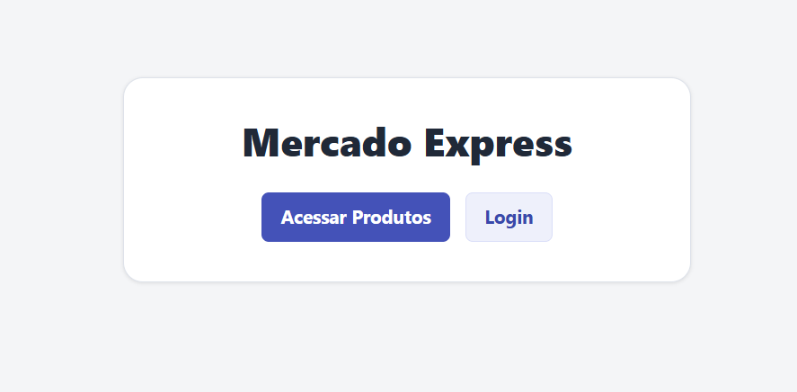
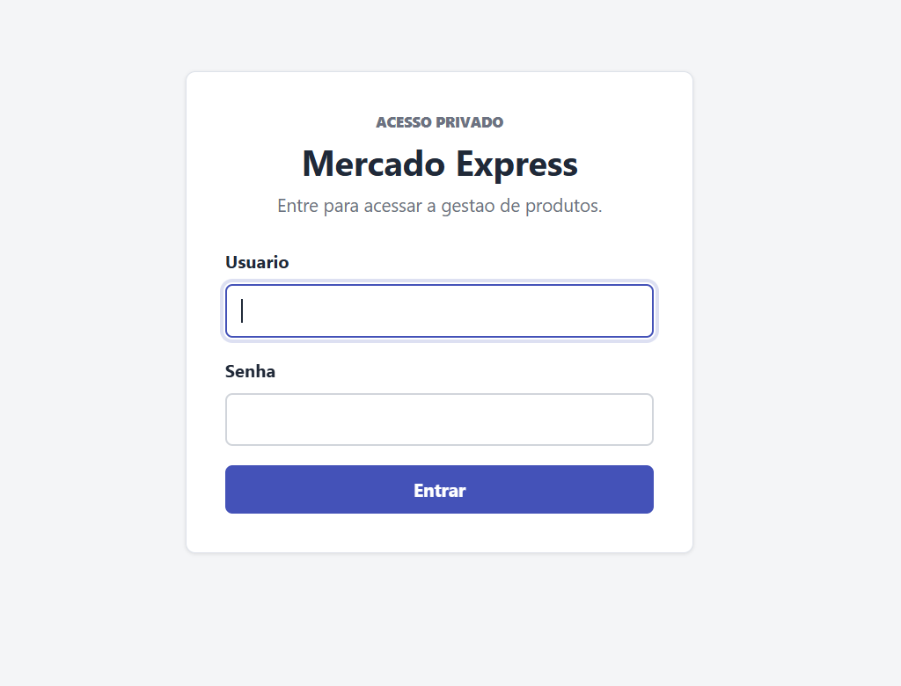
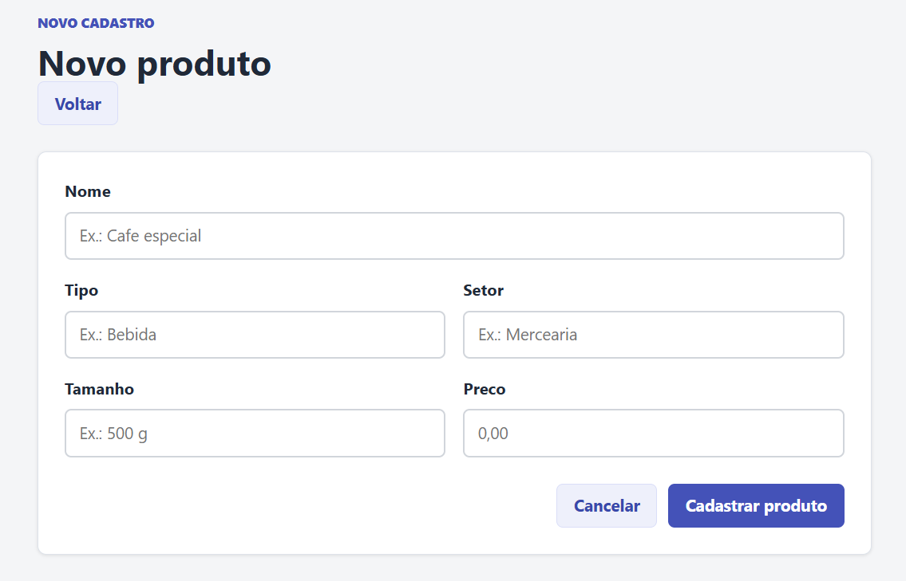
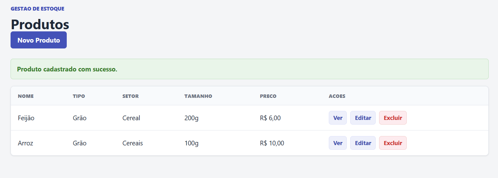
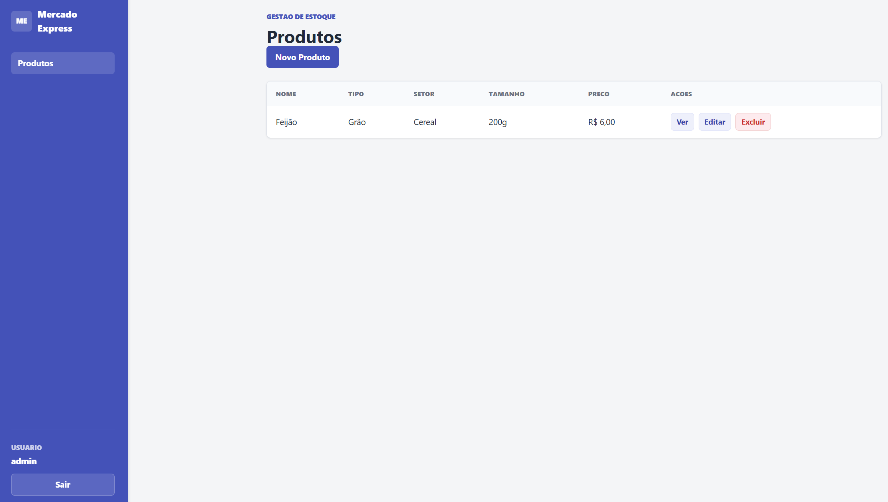
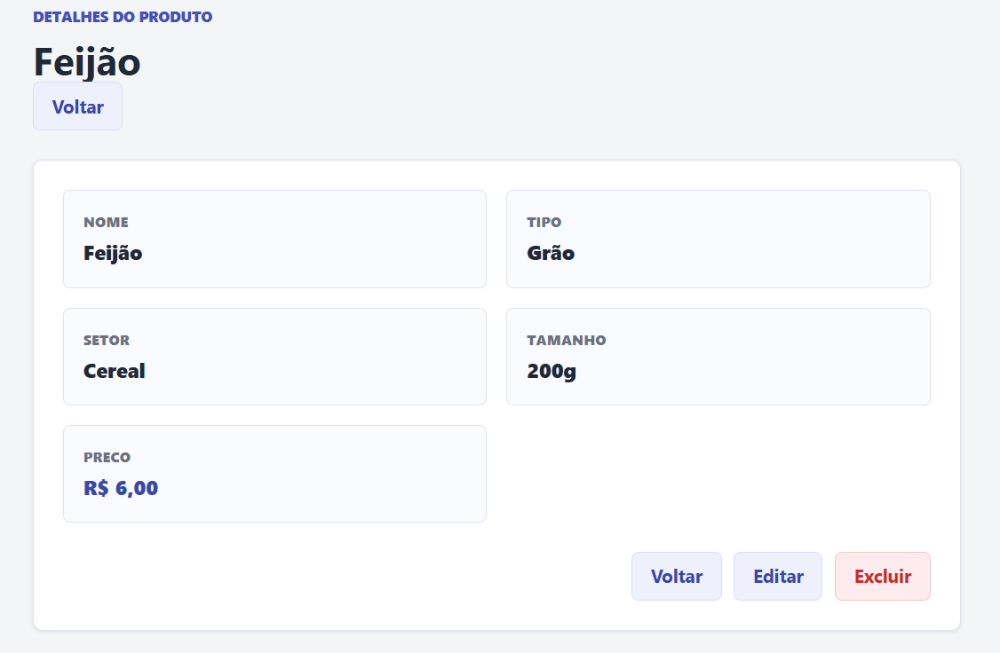
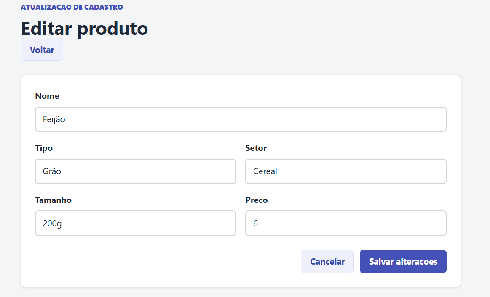
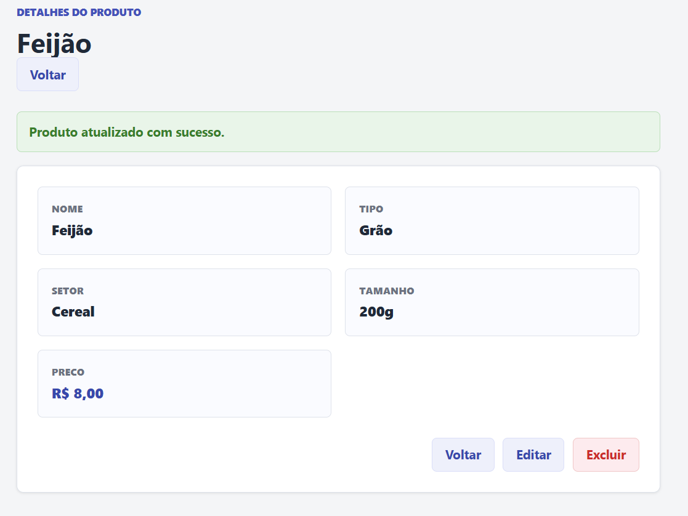
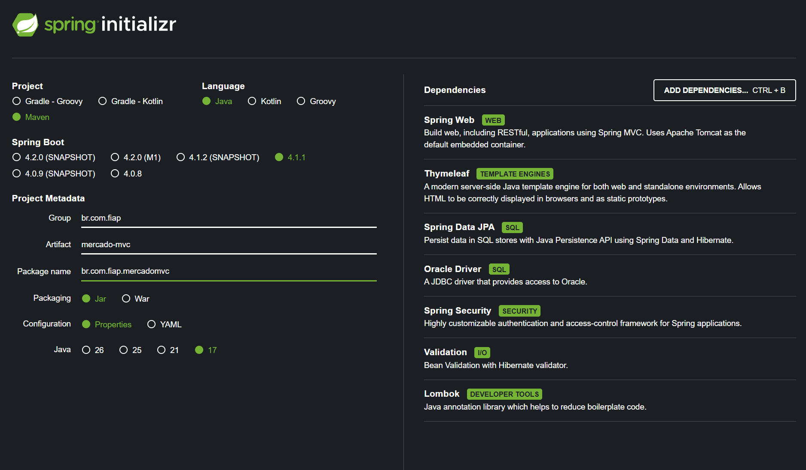

# Mercado Express — CP5 Fase 2D

O projeto inclui a base concluida da Parte 1, compras e estoque da Fase 2A, a integracao de pagamentos e notificacoes da Fase 2C e o dashboard administrativo da Fase 2D.

## Dashboard administrativo — Fase 2D

Administradores autenticados acessam `GET /admin/dashboard`. A pagina apresenta receita e lucro de compras aprovadas, contagens por status, estoque atual e historico de compras. O lucro usa exclusivamente os snapshots de preco e custo gravados em cada item no momento da compra; alteracoes posteriores no cadastro do produto nao mudam o resultado historico. Usuarios `CLIENTE` recebem `403 Forbidden`, e o link do dashboard nao e renderizado para eles.

## Pagamento e notificacao — Fase 2C

Ao criar uma compra, a mesma transacao que reserva estoque e persiste `CP5_COMPRA` cria uma tentativa em `CP5_PAYMENT_OUTBOX`. Um scheduler publica o envelope duravel no RabbitMQ somente depois do commit. Falhas do broker deixam a linha como `PENDING`, com contador, instante e erro da ultima tentativa, para recuperacao automatica sem gerar um novo `paymentAttemptId`.

O consumidor de `mercado.payment.results` valida `paymentAttemptId`, compra, `correlationId`, valor e moeda antes de reutilizar as regras da Fase 2A. `APPROVED` mantem o estoque ja reservado e cria uma unica notificacao; `REJECTED` libera o estoque e nao cria email. Duplicatas terminais nao alteram estoque nem criam outra notificacao. Resultados malformados, desconhecidos ou conflitantes seguem para `mercado.payment.results.dlq`.

O cadastro de novos clientes exige um email valido e separado do login. A V4 deixa o campo nullable somente para compatibilidade com contas legadas. Se uma conta antiga sem email receber aprovacao, a notificacao e registrada como `FAILED` com a causa, sem inventar um destinatario.

O transporte de email usa a interface `EmailTransport`:

- `smtp`, padrao local, envia para Mailpit em `localhost:1025`; a mensagem e apenas capturada localmente em `http://localhost:8025`, nao entregue na internet;
- `https-api`, preparado para Render Free, envia JSON por HTTPS com bearer token. Nenhum provedor, endpoint ou token real foi configurado nesta fase.

O passo a passo completo de tres aplicacoes e infraestrutura local esta em [docs/phase-2c-local.md](docs/phase-2c-local.md).

## Configuracao CP5 com PostgreSQL

O perfil `postgres` habilita as migrations e a autenticacao pelo banco. Crie um banco local vazio e um usuario proprio. Exemplo para `psql`, substituindo o valor indicado por uma senha local:

```sql
CREATE ROLE mercado_cp5_app LOGIN PASSWORD '<senha-local-segura>';
CREATE DATABASE mercado_cp5 OWNER mercado_cp5_app;
```

Configure somente a sessao atual do PowerShell:

```powershell
$env:SPRING_PROFILES_ACTIVE="postgres"
$env:DB_URL="jdbc:postgresql://localhost:5432/mercado_cp5"
$env:DB_USERNAME="mercado_cp5_app"
$env:DB_PASSWORD="<senha-local-segura>"
```

Nao existem credenciais nem connection strings de fallback no codigo. Confirme que `DB_URL` aponta para o banco local correto antes de iniciar a aplicacao, pois o Flyway executa automaticamente:

- `V1__create_product_schema.sql`: sequence e tabela de produtos;
- `V2__create_user_schema.sql`: sequence, tabela de usuarios, login unico e perfis permitidos;
- `V3__create_purchase_and_inventory_schema.sql`: estoque e custo dos produtos, compras, itens e sequences correspondentes.
- `V4__create_payment_outbox_and_email_notification.sql`: email do cliente, outbox transacional e historico de entrega de notificacoes.

O Hibernate usa `ddl-auto=validate` no PostgreSQL; a estrutura e criada pelo Flyway.

### Provisionamento do primeiro ADMIN

Nao existe cadastro publico de administrador. Para criar o primeiro `ADMIN`, defina antes da primeira inicializacao:

```powershell
$env:APP_ADMIN_USERNAME="<login-administrador>"
$env:APP_ADMIN_PASSWORD="<senha-administrador-segura>"
$env:APP_ADMIN_NAME="<nome-administrador>"
```

O provisionador cria a conta somente se o login nao existir. Ele nao eleva uma conta `CLIENTE` existente e nao substitui a senha de um administrador ja persistido. Depois do provisionamento inicial, essas variaveis podem ser removidas do ambiente.

### Execucao PostgreSQL

```powershell
.\mvnw.cmd spring-boot:run
```

A aplicacao fica em `http://localhost:8082`. `/registro` e publico apenas no perfil PostgreSQL; toda conta criada nessa pagina recebe obrigatoriamente o perfil `CLIENTE`.

### Perfis e permissoes

| Acao | ADMIN | CLIENTE |
| --- | --- | --- |
| Listar e ver produtos | Sim | Sim |
| Criar produtos | Sim | Nao |
| Atualizar produtos | Sim | Nao |
| Excluir produtos | Sim | Nao |
| Mutacoes na API REST | Sim | Nao |

As permissoes sao aplicadas pelo Spring Security no servidor. Os controles administrativos tambem sao removidos do HTML do cliente; tentativas autenticadas sem permissao retornam `403 Forbidden`.

### Testes

Os testes usam H2 isolado em memoria e nao acessam PostgreSQL, Oracle, DEV ou producao:

```powershell
.\mvnw.cmd clean test
.\mvnw.cmd clean package
```

Eles cobrem validacao e duplicidade no cadastro, BCrypt, autenticacao persistida, autorizacao MVC/REST, compatibilidade do CRUD, compras, estoque, outbox, contratos JSON, resultados de pagamento, duplicatas e entrega/falha de email.

## Compras e estoque — Fase 2A

O `ADMIN` informa estoque disponivel e custo de aquisicao ao criar ou editar produtos. O `CLIENTE` consulta o estoque pela API de produtos e cria compras pela API REST. O servidor identifica o cliente pela sessao autenticada e consulta preco e custo no banco; por isso, o JSON de entrada nao aceita login, ID de usuario, preco nem total.

### Endpoints

| Metodo | Rota | Perfil | Funcao |
| --- | --- | --- | --- |
| GET | `/api/mercado` | ADMIN, CLIENTE | Consultar produtos e estoque disponivel |
| POST | `/api/compras` | CLIENTE | Criar uma compra e reservar estoque |
| GET | `/api/compras` | CLIENTE | Listar somente as compras do cliente autenticado |
| GET | `/api/compras/{id}` | CLIENTE | Consultar uma compra propria |
| GET | `/api/compras` | ADMIN | Listar compras de todos os clientes |
| GET | `/api/compras/{id}` | ADMIN | Consultar qualquer compra |

Exemplo para Postman, autenticado como `CLIENTE`:

```http
POST /api/compras
Content-Type: application/json
```

```json
{
  "itens": [
    {
      "produtoId": 1,
      "quantidade": 2
    },
    {
      "produtoId": 2,
      "quantidade": 1
    }
  ]
}
```

A resposta `201 Created` contem o cliente obtido da autenticacao, itens com precos capturados no momento da compra, total calculado pelo servidor, moeda `BRL`, status e `correlationId`.

### Ciclo de vida e regras de estoque

1. A criacao bloqueia os registros dos produtos em ordem de ID dentro de uma unica transacao, valida todos os itens e impede quantidade zero, negativa, produto duplicado ou estoque insuficiente.
2. O estoque disponivel e reduzido ao criar a compra. Essa reducao representa uma reserva e a compra nasce como `PENDING_PAYMENT`.
3. Um resultado `APPROVED` finaliza a compra sem nova alteracao de estoque, pois a reserva ja consumiu a disponibilidade.
4. Um resultado `REJECTED` restaura exatamente uma vez as quantidades reservadas.
5. O processamento bloqueia a compra, confere ID de correlacao, valor e moeda. Repetir o mesmo resultado terminal e ignorado com seguranca; um resultado terminal conflitante e rejeitado.

Preco, custo unitario, nome do produto, total de venda e custo total sao armazenados como snapshots. Assim, alteracoes futuras no produto nao mudam o historico nem o calculo posterior de lucro.

### Preparacao para mensageria e pagamento

Os contratos internos `PaymentRequest` e `PaymentResult` carregam ID da compra, `correlationId`, valor, moeda e status de pagamento sem depender de RabbitMQ ou de um formato externo. Nesta fase eles sao usados somente pelo dominio e nao existe endpoint que aprove compras automaticamente.

O contrato oficial do Banco Tranquilo nao foi encontrado no repositorio. A proxima fase precisa receber ou localizar essa especificacao antes de criar o adaptador HTTP; o formato da API externa nao deve ser inferido a partir destes DTOs internos.

## Compatibilidade Oracle

`oracle` permanece como perfil padrao ate que o cutover seja aprovado. Ele mantem o CRUD existente e a autenticacao administrativa legada, agora obrigatoriamente configurada por ambiente. Flyway e cadastro publico ficam desabilitados, e nenhuma tabela Oracle e criada ou alterada.

```powershell
$env:SPRING_PROFILES_ACTIVE="oracle"
$env:DB_URL="<jdbc-url-oracle>"
$env:DB_USERNAME="<usuario-oracle>"
$env:DB_PASSWORD="<senha-oracle>"
$env:APP_USERNAME="<login-administrativo-legado>"
$env:APP_PASSWORD="<senha-administrativa-legada>"
```

Nenhuma infraestrutura de producao foi alterada nesta fase.

## Documentacao historica do CP4

## Sobre o projeto

Mercado Express é uma aplicação Spring MVC desenvolvida para o **FIAP Java Advanced — Checkpoint 4 Parte II: Spring MVC, Security e Deploy**.

O sistema permite que usuários autenticados gerenciem produtos de mercado por uma interface web renderizada com **Spring MVC + Thymeleaf**. Os dados são persistidos em banco **Oracle** por meio de Spring Data JPA, e as rotas privadas são protegidas com Spring Security.

## Requisitos

- Spring Boot 4.1.1
- Maven
- Java 17
- Spring MVC com `@Controller`
- Thymeleaf
- CRUD web completo
- Persistência em Oracle
- Spring Security com rotas públicas e privadas
- Lombok
- Bean Validation
- Projeto preparado para deploy com Docker no Render
- API REST adicional com DTOs, validação, tratamento de erros e HATEOAS

A API REST/HATEOAS é uma funcionalidade adicional para demonstrar conceitos praticados na Parte I. A entrega principal da Parte II continua sendo a aplicação MVC com Thymeleaf e Spring Security.

## Tecnologias utilizadas

- Java 17
- Spring Boot 4.1.1
- Spring Web MVC
- Thymeleaf
- Spring Data JPA
- Oracle JDBC Driver
- Spring Security
- Spring HATEOAS
- Bean Validation
- Lombok
- Maven
- Docker

## Arquitetura

Fluxo principal da aplicação web:

```text
Browser
   ↓
Spring Security
   ↓
MVC Controller
   ↓
Service
   ↓
Repository
   ↓
Oracle
```

Renderização HTML:

```text
MVC Controller
   ↓
Thymeleaf
   ↓
HTML
```

Fluxo adicional da API REST:

```text
REST Client
   ↓
REST Controller
   ↓
Service
   ↓
Repository
   ↓
Oracle
```

## Banco de dados Oracle

O projeto usa os objetos Oracle definidos em [docs/database/oracle-schema.sql](docs/database/oracle-schema.sql).

Tabela:

```text
TDS_MVC_TB_MERCADO
```

Sequence:

```text
TDS_MVC_SEQ_MERCADO
```

Campos persistidos:

| Campo | Tipo Java | Observação |
| ----- | --------- | ---------- |
| `id` | `Long` | Chave primária gerada pela sequence |
| `nome` | `String` | Obrigatório, até 120 caracteres |
| `tipo` | `String` | Obrigatório, até 50 caracteres |
| `setor` | `String` | Obrigatório, até 80 caracteres |
| `tamanho` | `String` | Obrigatório, até 40 caracteres |
| `preco` | `BigDecimal` | Obrigatório, maior que zero, escala de 2 casas |

A aplicação usa `spring.jpa.hibernate.ddl-auto=validate`, portanto não cria nem altera a estrutura do banco automaticamente.

## Interface Web com Thymeleaf

A rota `/` é pública e apresenta uma página inicial simples com acesso à área de produtos e à tela de login.

<p align="center">
  
</p>
<p align="center">
  <sub>Página inicial pública da aplicação.</sub>
</p>

A interface browser-facing usa templates Thymeleaf em `src/main/resources/templates` e recursos como `th:text`, `th:each`, `th:object`, `th:field`, `th:action`, `th:if` e `th:errors`.

## Segurança com Spring Security

A rota `/login` é pública. As rotas `/mercado/**` são privadas, e usuários não autenticados são redirecionados naturalmente para a tela de login antes de acessar a gestão de produtos.

<p align="center">
  
</p>
<p align="center">
  <sub>Tela pública de autenticação com formulário do Spring Security.</sub>
</p>

Rotas públicas:

- `/`
- `/login`
- assets estáticos em `/css/**`, `/images/**`, `/webjars/**` e `/favicon.ico`
- leitura REST em `GET /api/mercado` e `GET /api/mercado/{id}`

Rotas privadas:

- `/mercado/**`
- mutações REST em `/api/mercado/**`

A autenticação usa login por formulário do Spring Security. O logout é feito por `POST /logout`, com token CSRF nos formulários Thymeleaf.

As credenciais legadas nao possuem mais valores padrao e devem ser fornecidas por variaveis de ambiente.
## CRUD

Todas as operações do CRUD usam a tabela `TDS_MVC_TB_MERCADO` por meio do `MercadoService` e `MercadoRepository`.

### CREATE — Novo produto

O usuário acessa **Novo Produto**, preenche o formulário e envia `POST /mercado`. O formulário Thymeleaf recebe `nome`, `tipo`, `setor`, `tamanho` e `preco`, com Bean Validation aplicada aos campos.

<p align="center">
  
</p>
<p align="center">
  <sub>Formulário MVC para cadastro de produto.</sub>
</p>

Após a validação bem-sucedida, o fluxo é:

```text
Controller
→ Service
→ Repository
→ Oracle
```

A interface retorna para a listagem e mostra o estado de sucesso.

<p align="center">
  
</p>
<p align="center">
  <sub>Produto criado e persistido no Oracle.</sub>
</p>

### READ — Listagem de produtos

A listagem aparece em `GET /mercado`. O Thymeleaf renderiza a coleção retornada do Oracle e expõe as ações **Novo Produto**, **Ver**, **Editar** e **Excluir**.

<p align="center">
  
</p>
<p align="center">
  <sub>Lista de produtos renderizada com Thymeleaf.</sub>
</p>

### READ — Detalhes do produto

`GET /mercado/{id}` carrega um único produto e renderiza seus valores através do Thymeleaf.

<p align="center">
  
</p>
<p align="center">
  <sub>Detalhes de um produto carregado pelo ID.</sub>
</p>

### UPDATE — Editar produto

Ao acessar **Editar**, os valores existentes são carregados, o formulário é preenchido e o envio atualiza o mesmo registro Oracle com `PUT /mercado/{id}` usando o filtro de método oculto do Spring MVC.

<p align="center">
  
</p>
<p align="center">
  <sub>Formulário preenchido com os dados atuais do produto.</sub>
</p>

Após a atualização, o produto permanece salvo no Oracle com os novos valores.

<p align="center">
  
</p>
<p align="center">
  <sub>Produto atualizado e persistido.</sub>
</p>

### DELETE — Excluir produto

O usuário aciona **Excluir**, confirma a ação em um modal customizado e a remoção é enviada como `DELETE /mercado/{id}`. O formulário original mantém `_method=delete`, o token CSRF continua habilitado e o registro é removido do Oracle.

Não há screenshot de exclusão confirmado atualmente em `docs/images/`.

## Rotas MVC

| Método | Rota | Função |
| ------ | ---- | ------ |
| GET | `/` | Home pública |
| GET | `/login` | Página de login |
| GET | `/mercado` | Listar produtos |
| GET | `/mercado/novo` | Formulário de criação |
| POST | `/mercado` | Criar produto |
| GET | `/mercado/{id}` | Detalhes do produto |
| GET | `/mercado/{id}/editar` | Formulário de edição |
| PUT | `/mercado/{id}` | Atualizar produto |
| DELETE | `/mercado/{id}` | Excluir produto |

## API REST adicional

A API REST fica em `/api/mercado` e usa DTOs específicos, sem expor diretamente a entidade JPA.

| Método | Rota | Função |
| ------ | ---- | ------ |
| GET | `/api/mercado` | Listar produtos |
| GET | `/api/mercado/{id}` | Buscar produto por ID |
| POST | `/api/mercado` | Criar produto |
| PUT | `/api/mercado/{id}` | Atualizar produto completo |
| PATCH | `/api/mercado/{id}` | Atualizar campos parcialmente |
| DELETE | `/api/mercado/{id}` | Excluir produto |

O `PATCH` implementa atualização parcial verdadeira. Por exemplo, enviar apenas:

```json
{
  "preco": 6.49
}
```

altera somente o campo `preco`.

## HATEOAS

As respostas REST usam Spring HATEOAS com `RepresentationModelAssembler`, `EntityModel`, `CollectionModel`, `linkTo` e `methodOn`.

Exemplo simplificado de recurso:

```json
{
  "id": 1,
  "nome": "Café especial",
  "tipo": "Bebida",
  "setor": "Mercearia",
  "tamanho": "500 g",
  "preco": 19.90,
  "_links": {
    "self": {
      "href": "http://host/api/mercado/1"
    },
    "collection": {
      "href": "http://host/api/mercado"
    }
  }
}
```

Links:

- `self`: recurso atual
- `collection`: coleção completa de produtos

## Validação e tratamento de erros

A entidade e os DTOs validam campos obrigatórios, tamanho máximo e preço.

Na interface MVC, erros de formulário são exibidos no próprio template com `th:errors`.

Na API REST, erros de validação retornam `400 Bad Request` em JSON, e produtos inexistentes retornam `404 Not Found` em JSON. A página MVC continua usando a tela amigável `mercado/nao-encontrado.html`.

## Configuração do Spring Initializr

O projeto foi criado com as dependências necessárias para MVC, Thymeleaf, JPA, Oracle, Security, Validation e Lombok.

<p align="center">
  
</p>
<p align="center">
  <sub>Configuração final usada no Spring Initializr.</sub>
</p>

## Como executar localmente

Clone o repositório:

```powershell
git clone git@github.com:GusCrevelari/mercado-api-II.git
cd mercado-api-II
```

Configure as variáveis de ambiente:

```powershell
$env:SPRING_PROFILES_ACTIVE="oracle"
$env:DB_URL="<jdbc-url-oracle>"
$env:DB_USERNAME="<usuario-oracle>"
$env:DB_PASSWORD="<senha-oracle>"
$env:APP_USERNAME="<login-administrativo-legado>"
$env:APP_PASSWORD="<senha-administrativa-legada>"
```

Execute:

```powershell
.\mvnw.cmd spring-boot:run
```

Acesse:

```text
http://localhost:8082
```

## Deploy no Render com PostgreSQL

O projeto está publicado no Render:

```text
https://mercado-api-ii.onrender.com
```

Área de produtos em produção:

```text
https://mercado-api-ii.onrender.com/mercado
```

O deploy do CP5 usa PostgreSQL. O Java Web Service e o banco PostgreSQL devem pertencer ao mesmo workspace e estar na mesma região do Render para que a rede privada e o hostname interno funcionem.

Configure as variáveis abaixo no Java Web Service. Use o hostname interno exibido pelo Render, mantenha as credenciais separadas da URL e não salve valores reais no repositório:

```text
SPRING_PROFILES_ACTIVE=postgres
DB_URL=jdbc:postgresql://<hostname-interno-render>:5432/<nome-do-banco>
DB_USERNAME=<usuario-postgresql>
DB_PASSWORD=<senha-postgresql>
```

O primeiro usuário `ADMIN` já foi provisionado no banco do CP5. As variáveis `APP_ADMIN_USERNAME`, `APP_ADMIN_PASSWORD` e `APP_ADMIN_NAME` não são necessárias nos próximos deploys e devem permanecer ausentes. O cadastro público cria exclusivamente usuários com perfil `CLIENTE`; a autenticação, o cadastro e as permissões `ADMIN`/`CLIENTE` usam os usuários persistidos no PostgreSQL.

Durante a inicialização, o Flyway consulta `flyway_schema_history`, valida as migrations existentes `V1` e `V2` e não recria tabelas que já foram migradas com sucesso. Em seguida, o Hibernate valida o schema sem alterá-lo.

### Configuração legada Oracle

As antigas variáveis de Render `APP_USERNAME`, `APP_PASSWORD` e a URL JDBC do Oracle pertencem somente ao perfil legado `oracle`. Elas não fazem parte do deploy PostgreSQL do CP5. Não ative os perfis `postgres` e `oracle` simultaneamente.

O Dockerfile usa Java 17, build multi-stage e respeita a porta injetada pelo Render via variável `PORT`, pois a aplicação está configurada com:

```properties
server.port=${PORT:8082}
```

## Estrutura do projeto

```text
.
├── Dockerfile
├── README.md
├── docs
│   ├── database
│   │   └── oracle-schema.sql
│   └── images
│       ├── 1-login.png
│       ├── 2-home.png
│       ├── 03-produtos.png
│       ├── 05-novo-produto.png
│       ├── 05-produto-criado.png
│       ├── 06-detalhes.png
│       ├── 07-editar-produto.png
│       ├── 08-produto-atualizado.png
│       └── spring-initializr.png
├── pom.xml
└── src
    └── main
        ├── java/br/com/fiap/mercadomvc
        │   ├── api
        │   ├── config
        │   ├── controller
        │   ├── exception
        │   ├── model
        │   ├── repository
        │   └── service
        └── resources
            ├── application.properties
            ├── static/css/style.css
            └── templates
```
